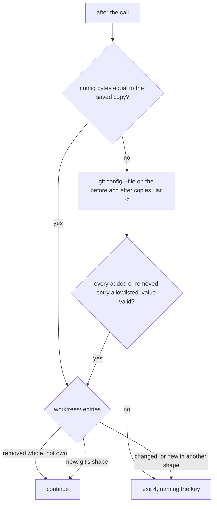

# The implementer's snapshot lets the user's own branch tracking and worktrees through

## Goal

`run-implementer.sh` stops a run with exit 4 whenever a byte of the shared git config or a worktree's pointers changed during the call, so the user's own `git push -u`, `git branch --set-upstream-to`, `git branch -d` or `git worktree add` in another checkout stops it too. After this change the launcher compares git's own parse of the config and lets through only branch-tracking entries with checked values, and accepts a new or removed worktree entry that has exactly the shape git gives it. Everything else still exits 4. The why is in the [research note](~/notes/research/2026-10-02-implementer-snapshot-false-alarm.md).

## Decision

Option C of the research: a parsed allowlist for the config, and a shape check for worktree entries. It keeps "stop on anything unknown", so a key git adds in a later release fails closed.

- Rejected, A (do nothing): every `push -u` or `worktree add` during a run costs a rerun.
- Rejected, B (a denylist of keys that run programs): even `branch.<name>.remote`, which `push -u` writes, is used as a URL when it names no configured remote ([git remote.c v2.54.0](https://github.com/git/git/blob/v2.54.0/remote.c#L785-L806) ([research](~/notes/research/2026-10-02-implementer-snapshot-false-alarm.md) [7])), and the list of keys that run programs keeps growing (research, Findings).

## Background

Read at `18ee9ac` on 2026-10-10, on `main`. First read on 2026-10-03 at `b4d4057`, the head of `implement/2026-10-02-implementer-refuses-network-setting`, the network-setting fix this spec builds on, which is now on `main`. Local git is 2.54.0 (`git --version`), the version the research read.

**The snapshot today.**
- `snapshot()` (`skills/implement/scripts/run-implementer.sh:274-417`) records, without running git, a state per path: mode and sha256, `missing`, a link target, `dir` or another file type (`state()`, :289-307). The paths (`watched()`, :322-333) are `<common>/config`, `<common>/config.worktree`, `<worktree>/.git`, everything under `<common>/hooks`, each `worktrees/*/{config.worktree,commondir,gitdir}` (:326-327), and each `config` and `hooks` entry under `<common>/modules`.
- It runs before the call, saving that state to `<run dir>/snapshot.json` (:524), and again after it, given that file, in `git_unchanged()` (:457-468), which runs after a finished call (:552) and after an interrupted one (:517). Any path whose state differs prints `changed: <path>` (:406-408); any line but a `moved:` one exits 4 (:461-467), a `program:` line for a submodule config under the worktree's git dir that names a program among them (:383-399). Only hashes are kept, so the before-bytes of the config are gone by the time it compares.
- Refs and `HEAD` that moved are named in a `moved during the run:` line without stopping (`refs()`, :335-360, and :460), as are the user's commits (`tests/test_run_implementer.py:456-470`).

**Who can write these files.** The implementer's sandbox denies writes to `<common>/config`, `hooks`, `modules`, and its own `config.worktree`, `commondir` and `gitdir` (`skills/implement/implementer-settings.json:45-59`). It may write its own git dir, `<common>/worktrees/<own id>` (`skills/implement/implementer-settings.json:38`, set from `git rev-parse --git-dir` at `skills/implement/scripts/run-implementer.sh:113`). Each other worktree's `commondir`, `gitdir`, `HEAD`, `config.worktree` and `index` are added to `denyWrite` at launch (:231-243). So a change to the shared config, or a new or removed `worktrees/<id>/` entry, comes from the user or from a gap in the sandbox; the snapshot is the second line of defence.

**What the user's git writes** (git v2.54.0; the `push -u` and `worktree add` facts are CONFIRMED in the research's Verification table, and branch `-d`/`-m`/`-c` was checked at source by this spec's verifier):
- `git push -u` and `fetch --set-upstream` write `branch.<b>.remote`, `branch.<b>.merge`, and `branch.<b>.rebase=true` when `branch.autoSetupRebase` applies ([branch.c](https://github.com/git/git/blob/v2.54.0/branch.c#L91-L140), [transport.c](https://github.com/git/git/blob/v2.54.0/transport.c#L1536) (research [1][2])); `branch --set-upstream-to` and `checkout -b` from a remote branch write the same *(unverified)*.
- `git branch -d`, `-m` and `-c` remove, rename or copy the whole `[branch "<b>"]` section ([builtin/branch.c](https://github.com/git/git/blob/v2.54.0/builtin/branch.c#L214), and L664-667 for rename and copy (research [3])).
- `git worktree add` creates `worktrees/<id>/` with `gitdir` holding the absolute `<path>/.git` and `commondir` holding `../..`, and copies `config.worktree` minus `core.bare` and `core.worktree` when `extensions.worktreeConfig` is on ([builtin/worktree.c](https://github.com/git/git/blob/v2.54.0/builtin/worktree.c#L500-L583) (research [6])). `commondir` is the file that redirects a worktree; `gitdir` is only a back-pointer ([gitrepository-layout](https://github.com/git/git/blob/v2.54.0/Documentation/gitrepository-layout.adoc) (research [17])).

**What can run a program inside those sections.** `branch.<b>.mergeOptions` takes any `git merge` option *(unverified)*, and `-s <name>` runs `git-merge-<name>` from `PATH` ([builtin/merge.c](https://github.com/git/git/blob/v2.54.0/builtin/merge.c#L195) (research [9])); `branch.<b>.rebase=interactive` opens an editor ([branch.adoc](https://github.com/git/git/blob/v2.54.0/Documentation/config/branch.adoc) (research [8])); `remote.<r>.uploadpack`, `receivepack`, `vcs` and `url` run or redirect ([remote.adoc L6-17](https://github.com/git/git/blob/v2.54.0/Documentation/config/remote.adoc#L6-L17) and [L55-73](https://github.com/git/git/blob/v2.54.0/Documentation/config/remote.adoc#L55-L73) (research [10])). Neither holds W1 up: no `mergeOptions` or `remote.*` key is on the allowlist, so each exits 4 whatever it does.

**Parsing.** `git config --file <f> --list` doesn't follow includes by default ([git-config.adoc](https://github.com/git/git/blob/v2.54.0/Documentation/git-config.adoc) (research [20])). Git's own section rename and remove misread long values before 2.40.1 (CVE-2023-29007) ([advisory](https://github.com/git/git/security/advisories/GHSA-v48j-4xgg-4844) (research [19])), so parse with git, not with the launcher's own `keys()` (`skills/implement/scripts/run-implementer.sh:362-381`).

**Where it's documented.** The launcher's header says exit 4 means the call changed "the repo's shared git config, hooks or a worktree's git pointers" (`skills/implement/scripts/run-implementer.sh:32-34`); `skills/implement/SKILL.md:86` and `docs/containment.md:70` say the same.

## Non-goals

- `gh pr checkout` of a fork pull request the maintainer can modify, which stores the fork's URL as `branch.<b>.remote` ([cli checkout.go v2.102.0](https://github.com/cli/cli/blob/v2.102.0/pkg/cmd/pr/checkout/checkout.go#L295-L308) (research [4])): still exits 4. Widen only if it happens.
- `git remote add`, `rename` or `set-url`, `worktree add --relative-paths`, `worktree move`, and any `remote.*` or `extensions.*` change during a run: still exit 4.
- Hooks, submodule configs and the implementer's own pointers: still compared byte for byte.
- The `moved during the run:` line for refs: unchanged.
- The research's test of "a config with a continuation line hiding a key" (research, Next step): with git's own parse, a continued line is part of a value and can't hide a key, so it tests only a parser of the launcher's own, which W1 doesn't use.

## Design

**Config.** Before the call, the launcher copies `<common>/config`, `<common>/config.worktree` and each `worktrees/*/config.worktree` into `<run dir>/git-before/`, outside the implementer's `allowWrite`: `/implement` passes `~/.cache/implement-runs/<run name>/implementer` (`skills/implement/SKILL.md:44`), a sibling of the scratch dir that `allowWrite` holds. The launcher's own check takes any name in that last place (`skills/implement/scripts/run-implementer.sh:121`), so the copies rely on the name `/implement` gives, as `snapshot.json` (:524) already does. In the unit tests the whole fixture sits under the per-user temp dir, which `allowWrite` also holds; nothing sandboxes the tests' stub, so this doesn't matter there. After it, it copies into `<run dir>/git-after/` the two common files and the `config.worktree` of each `worktrees/<id>/` that is new since the call began, so both sides are read from copies, not from files that could still change. Only the two common files are compared as below: an existing worktree's `config.worktree` keeps its byte check, and a new or removed one is left to the worktree rules, since `git worktree add` writes one and `git worktree remove` deletes one with its whole entry. If a common file's bytes differ, it lists both copies with `git config --file <copy> --no-includes --list -z`, in a subshell that `cd`s to the run dir (the launcher is in `$work` by then, `skills/implement/scripts/run-implementer.sh:532`), with `GIT_CONFIG_NOSYSTEM=1`, `GIT_CONFIG_GLOBAL=/dev/null`, and `GIT_CEILING_DIRECTORIES` set to the run dir's parent so git looks for no repo above it. This runs nothing a config sets and follows no include, even with `$HOME` inside a repo whose config sets `core.fsmonitor` (spike S1, `docs/specs/spikes/2026-10-03-implementer-snapshot-false-alarm-results.md`). Each `-z` record is `key\nvalue\0`, and a key with no value is `key\0` with no newline (S1), so the parse splits on the first newline only if there is one. A missing file counts as an empty list; a file that fails to parse exits 4. Both copy dirs are deleted once the config and worktree checks are both done, since the config can hold a token in a remote URL. The checks replace the byte check inside the after-call check, `git_unchanged()` (`skills/implement/scripts/run-implementer.sh:457-468`), so they run after a finished call (:552) and after an interrupted one (:517). It compares the two lists as multisets of (key, value). A removed entry passes if its key starts with `branch.`, wider than the research's allowlist, which takes the same five keys for removals as for additions (research, Recommendation 2): removing a branch's keys can't make git run anything, and `git branch -d` removes keys other tools wrote too, such as `branch.<b>.vscode-merge-base` *(assumption)*. An added entry passes only if its key matches `^branch\..+\.(remote|pushremote|merge|rebase|description)$` (matched on the last part, since a branch name can contain dots) and its value passes:
- `remote`, `pushremote`: `.`, or a name with a `remote.<name>.url` in the before list;
- `merge`: starts with `refs/`;
- `rebase`: `true`, `false` or `merges`;
- `description`: any.

Any other added entry, or a removed one outside `branch.*`, an `include.*` or `includeIf.*` key among them, exits 4 with `changed: <file> sets <key>`.

If spike question 1 finds that the listing can run something, W1 doesn't start: the Design goes back for revision, and the byte check stays.

**Worktree entries.** The snapshot also records which `worktrees/<id>/` dirs exist. After the call:
- an entry gone as a whole, its `config.worktree` with it, other than the implementer's own, passes;
- a new `<id>` passes only if its `commondir` is `../..`, its `gitdir` holds an absolute `
/.git` with `
` outside the implementer's worktree, run dir and scratch dir, `
/.git` reads `gitdir: <common>/worktrees/<id>`, and its `config.worktree`, read from `git-after/`, is absent or lists the same entries as the `git-before/` copy of some worktree's `config.worktree` once that copy's `core.worktree` entries are dropped, and its `core.bare` entries with the value `true` if it reads `core.bare` as true. Git copies the file from the worktree `git worktree add` runs in, not always the main one, and unsets just those entries, so a `core.bare = false` is copied as it is (`copy_filtered_worktree_config` in [builtin/worktree.c v2.54.0](https://github.com/git/git/blob/v2.54.0/builtin/worktree.c#L361-L393), L380-390 for the two keys);
- any change to an entry that existed before still exits 4.

The implementer can't create a `worktrees/<id>/` entry itself: only its own git dir is in `allowWrite`. The `
` rule is for a gap in the sandbox, so that an entry in git's shape still can't make the user's next git command use a checkout the implementer can write. The per-user temp dir isn't in that list: this repo's own tests keep their repos there (`tests/test_run_implementer.py:87-89`).

Everything else in `watched()` stays byte for byte.

## Work items

### W1: the shared config is compared by git's parse, with a branch-tracking allowlist

- **Change:** in `run-implementer.sh`, copy the two common config files before and after the call, and in the after-call check replace their byte check with the comparison in Design. The header comment's exit 4 sentences (`skills/implement/scripts/run-implementer.sh:32-35`) say which config changes pass.
- **Files:** `skills/implement/scripts/run-implementer.sh`, `tests/test_run_implementer.py`.
- **Before it:** spike question 1 answered yes; see Design.
- **Done when:** `python3 -m unittest tests.test_run_implementer` passes, with new tests, each failing first where it says so, through `stub_does` (`tests/test_run_implementer.py:384-392`) acting in the main checkout during the call, with a bare remote `origin` added and pushed to before the launch. `<b>` is the main checkout's branch, read with `git symbolic-ref --short HEAD` as the existing commit test does (`tests/test_run_implementer.py:458`), since the fixture's default branch name varies:
  - exit 0, failing first: `git push -u origin <b>`; `git branch --set-upstream-to origin/<b>`; `git branch -d` of a second branch that has tracking keys and a `branch.<x>.vscode-merge-base` key; `git branch -m` of one with tracking keys; `git config branch.<b>.description x`;
  - exit 4 naming the key: `git config branch.<b>.remote /some/path`; `git config branch.<b>.mergeOptions "-s x"`; `git config branch.<b>.rebase interactive`; `git config remote.origin.uploadpack x`; `git config include.path x`;
  - the existing `core.fsmonitor` case (`tests/test_run_implementer.py:398-399`) still exits 4;
  - after a run, `<run dir>/git-before/` and `git-after/` don't exist.

### W2: a new or removed worktree entry in git's shape passes

- **Change:** in `snapshot()`, record the `worktrees/<id>/` dirs; copy each `worktrees/*/config.worktree` into `git-before/` before the call, and each new entry's into `git-after/` after it; in the after-call check, apply Design's worktree rules in place of the byte check on a new or missing entry's files; and delete the copy dirs only once this check is done too.
- **Files:** `skills/implement/scripts/run-implementer.sh`, `tests/test_run_implementer.py`.
- **Done when:** `python3 -m unittest tests.test_run_implementer` passes, with new tests, each adding a second worktree `other` before the launch, as the exit-4 cases do (`tests/test_run_implementer.py:420-421`): `git worktree add` from the main checkout during the call exits 0, failing first; with `extensions.worktreeConfig` on and a `config.worktree` in `other` that differs from the main checkout's, `git worktree add` run from `other` exits 0, failing first; with `extensions.worktreeConfig` on and `core.bare = false` in the main checkout's `config.worktree`, `git worktree add` from the main checkout exits 0, failing first; `git worktree remove` of `other` exits 0, failing first, and so does it with `extensions.worktreeConfig` on and entries in `other`'s `config.worktree`; a new entry whose `commondir` points elsewhere exits 4; a new entry whose `
` is inside the implementer's worktree exits 4; the existing case that rewrites another worktree's `commondir` (`tests/test_run_implementer.py:407-408`) still exits 4; and after a run in which a worktree was added, `<run dir>/git-before/` and `git-after/` don't exist.

### W3: the docs and evals

- **Change:** `skills/implement/SKILL.md:86` and `docs/containment.md:70` say that branch-tracking changes and new or removed worktrees made in another checkout don't stop the run. Run the implement skill evals, as `CLAUDE.md:35-38` asks for a change to `skills/implement/`, and the full agent evals, as `CLAUDE.md:23-26` asks for a changed skill file, each on both models, one set after the other (`CLAUDE.md:31-34`).
- **Files:** `skills/implement/SKILL.md`, `docs/containment.md`, `tests/agent-evals/BASELINE.md`.
- **Done when:** `python3 -m unittest discover -s tests` and `python3 tests/replay_guard.py` pass; `EVAL_MODEL=sonnet tests/skill-evals/run.sh implement-basic implement-trap implement-hand-edit`, then with `EVAL_MODEL=opus`, print `PASS` for all three cases; `tests/agent-evals/run.sh` runs in full with `EVAL_MODEL=sonnet`, then `EVAL_MODEL=opus`; and every case's result and cost, the implementer's and verifiers' included, is in a dated `BASELINE.md` section with a column per model.

## Effort

| Item | Estimate | Depends on |
|---|---|---|
| W1 | half a day | spike question 1, answered; the network-setting fix, now on `main` |
| W2 | half a day | W1 |
| W3 | 1 hour, plus the evals | W2 |

From reading the code, not building it. The research put C at about a day, about 120 lines of Python and ten test cases *(inferred, research, Options)*, which W1 and W2 split. The evals cost about $10.70: $3.93 for `implement-basic` and `implement-trap` on both models, agents included, plus a full agent-eval run at $1.91 on Sonnet and $4.46 on Opus, at their 2026-10-01 pass (`docs/specs/2026-10-02-implementer-sandbox.md`, Effort, deriving both from `tests/agent-evals/BASELINE.md:1446-1454`), plus `implement-hand-edit`, which stops at the gate and so costs only its skill session: $0.15 on Sonnet and $0.27 on Opus on 2026-10-09 (`tests/agent-evals/BASELINE.md:1701`).

## Spike questions

1. Does `git config --file <copy> --no-includes --list -z`, run as Design says (from the run dir, with `GIT_CONFIG_NOSYSTEM=1`, `GIT_CONFIG_GLOBAL=/dev/null` and `GIT_CEILING_DIRECTORIES`), run nothing when the copy sets `core.fsmonitor`, `core.pager`, a `!` alias and `include.path`, and list every entry? Experiment: a copy whose commands `touch` a marker; run the listing; the marker is absent and the include's entries aren't listed. Then once more with `$HOME` inside a git repo whose own config sets `core.fsmonitor` to touch a marker. Run it before W1.
   Answered: yes; the listing showed all entries, the valueless key included, followed neither `include.path` nor `includeIf`, and touched no marker, outside a repo and with `$HOME` inside one (spike S1, `docs/specs/spikes/2026-10-03-implementer-snapshot-false-alarm-results.md`)
2. Which git does the macOS CI runner have, and does it carry the CVE-2023-29007 fix? Experiment: `git --version` in a step of `.github/workflows/tests.yml`'s job.
   Open: GitHub's macOS runner-image documentation lists its git version; not checked yet.

## Risks and rollback

- A home-grown parse disagreeing with git is how CVE-2023-29007 and CVE-2025-48384 worked (research, Counter-evidence); parsing with git 2.54.0 avoids that, and a git without the CVE-2023-29007 fix (2.40.1, or the 2.30.9–2.39.3 maintenance releases) would not. The launcher doesn't check the git version (spike question 2).
- A user who often checks out fork pull requests with `gh` during runs still gets exit 4 (Non-goals).
- Rollback: revert W2, then W1; the byte check returns.

## Open questions

- None.
